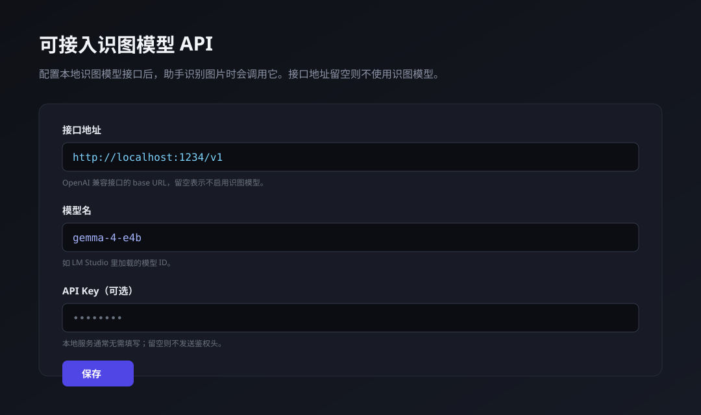
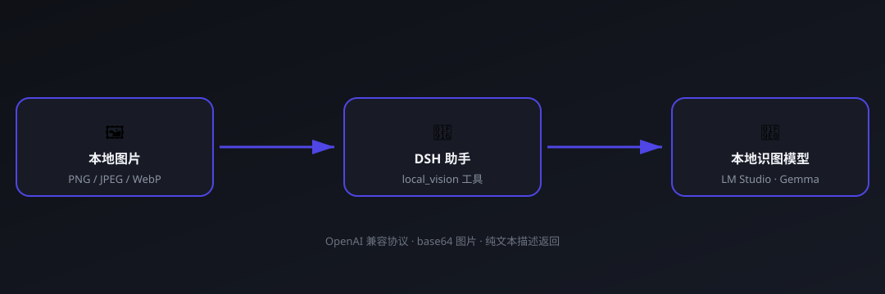

<h1 align="center">🖼 dsh-vision-api-localorweb</h1>

<p align="center">
  <b>接入本地识图模型 API</b> —— 给你的 DSH 助手装上一双「本地眼睛」。<br/>
  用 LM Studio / vLLM / Ollama 里的多模态模型来识图，数据不出本机。
</p>

<p align="center">
  
  
  
  
</p>

<p align="center">
  
</p>

---

## ✨ 为什么需要它

DSH 助手默认不「看」图片。这个插件把**你本地已有的识图模型**（比如 LM Studio 里跑着的 Gemma 4E）接进来：

- 🔌 **一行接入**：填个 OpenAI 兼容接口地址 + 模型名，即可启用
- 🔒 **数据不出本机**：图片只发给你自己的模型，不经过任何云端
- ⚙️ **留空即关闭**：接口地址留空 = 不启用识图，零副作用
- 🎛 **图形化配置**：设置界面里直接填，不用碰配置文件

## 🚀 快速开始

```sh
dsh plugin --profile web add "github:TIPSONG/dsh-vision-api-localorweb#main"
```

> 本插件声明了 `dsh.bundle.patch`，`dsh plugin add` 会自动挂进 profile 层栈，无需手写 insert 行。装完重启 web 生效。

重启后打开 **设置 → 可接入识图模型 API**：

| 字段 | 填什么 | 示例 |
| --- | --- | --- |
| 接口地址 | OpenAI 兼容 base URL | `http://localhost:1234/v1` |
| 模型名 | 本地加载的模型 ID | `gemma-4-e4b` |
| API Key | 本地服务留空即可 | *(空)* |

点**保存**，然后对助手说「看看这张图」——助手会调用 `local_vision` 把图片交给你本地的模型。

## 👁 怎么看图：两种方式

### 方式一：直接告诉助手图片路径（推荐，任何对话模型都可用）

把图片放在本地磁盘上，然后在对话里**给出图片路径**，例如：

> 看看这张图：`C:\Users\me\Desktop\photo.png`，描述一下内容

助手会调用 `local_vision` 工具读取该路径的图片、交给本地识图模型，并把文字描述带回来。**这条路不依赖对话模型是否支持图片输入**——哪怕对话模型是纯文本模型（如 deepseek-v4），识图也完全正常。

> ⚠️ 为什么拖拽发图不一定可行：DSH 会在消息提交时检查**当前对话模型**是否声明支持图片输入。如果对话模型不支持图片（如 deepseek-v4），拖拽/粘贴发图会被拒绝（提示「当前模型不支持图片」），且这个检查发生在插件无法拦截的位置。详见 [issue #1](https://github.com/TIPSONG/dsh-vision-api-localorweb/issues/1)。因此当对话模型不支持图片时，请用**路径识图**。

### 方式二：拖拽/粘贴发图（要求对话模型本身支持图片）

如果你的**对话模型**支持图片输入（例如把对话模型切换为本地多模态模型），直接拖图进对话框即可，图片会原样交给对话模型。此时本插件的转译钩子会自动跳过，不做干预。

## 🧭 工作原理

<p align="center">
  
</p>

## 📦 能力面

| Tools | 说明 |
| --- | --- |
| `local_vision` | 读取本地图片 → 交给 OpenAI 兼容识图接口 → 返回文字描述；接口留空时返回「未配置」提示 |

| UI | 说明 |
| --- | --- |
| 设置 → 可接入识图模型 API | 三个输入框（接口地址 / 模型名 / API Key），留空接口地址即禁用识图 |

## 🔧 配置字段

| 字段 | 说明 |
| --- | --- |
| `baseUrl` | OpenAI 兼容接口的 base URL（`http://host:port/v1`）。**留空 = 禁用识图** |
| `model` | 模型 ID（LM Studio 里加载的名字，如 `gemma-4-e4b`） |
| `apiKey` | 可选鉴权头；留空则不发送 |

## 📄 安装说明

**git 源（推荐，一行）：**

```sh
dsh plugin --profile web add "github:TIPSONG/dsh-vision-api-localorweb#main"
```

**本地目录：**

```sh
git clone https://github.com/TIPSONG/dsh-vision-api-localorweb.git
cd dsh-vision-api-localorweb
npm install
npm run build          # 产出 lib/index.js + lib/client.js
dsh plugin --profile web add .
```

> 本插件声明 `dsh.bundle.patch`（组合层）+ `dsh.client`（`platform: web`）+ `exports["./client"]`（浏览器设置页），`main` 提供 Node 工具半。安装后重启 web 生效。

## 🛠 开发

```sh
npm install
npm run build          # 重新构建 lib/
```

| 文件 | 说明 |
| --- | --- |
| `src/index.ts` | Node 半：settings namespace + `local_vision` 工具 |
| `src/client.ts` | 浏览器半：设置页 |
| `scripts/build.mjs` | esbuild 构建脚本（ESM host + `__ModuleLoader__` client bundle） |

## 🔌 支持的模型

任何 **OpenAI 兼容 `/v1/chat/completions`** 接口且支持图片输入的多模态模型：

- **LM Studio**（Gemma、Qwen-VL、LLaVA 等）
- **Ollama**（`http://localhost:11434/v1`）
- **vLLM** / **llama.cpp server**

## 📄 License

[MIT](LICENSE)
